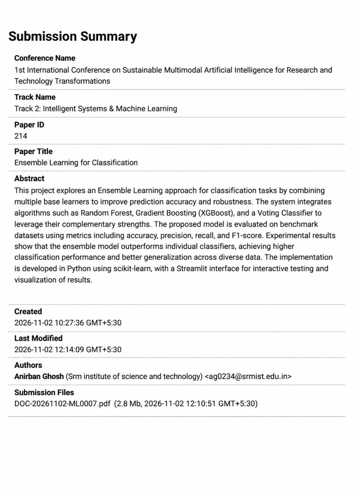

# Museum Ticketing System

A full-stack museum discovery and ticket booking application. The React frontend provides museum listings, details, booking, digital passes, account pages, an admin dashboard, and a FAQ chatbot. The Express backend uses SQLite for accounts, museums, exhibitions, and bookings.

## Tech stack

- React, Vite, and React Router
- Node.js and Express
- SQLite (`better-sqlite3`)

## Run locally

Install dependencies from the project root:

```powershell
npm install --prefix backend
npm install --prefix frontend
```

Seed the local database with the sample museum and exhibition data:

```powershell
npm run seed --prefix backend
```

Start the backend and frontend in separate terminals:

```powershell
npm start --prefix backend
```

```powershell
npm run dev --prefix frontend
```

Open the local URL printed by Vite (usually `http://localhost:5173`). Vite forwards `/api` requests to the backend at `http://127.0.0.1:5000` during development.

## Demo admin account

The backend initializes a local demo administrator account:

- Email: `admin@aurum.com`
- Password: `Admin@123`

This is for local demonstration only. Set a strong `JWT_SECRET` and replace demo credentials before deploying the backend for public use.

## Notes

The local SQLite database is intentionally excluded from Git because it may contain account and booking records. A fresh database is created when the backend starts; run the seed command above to populate sample museum data.

## Conference submission summary


